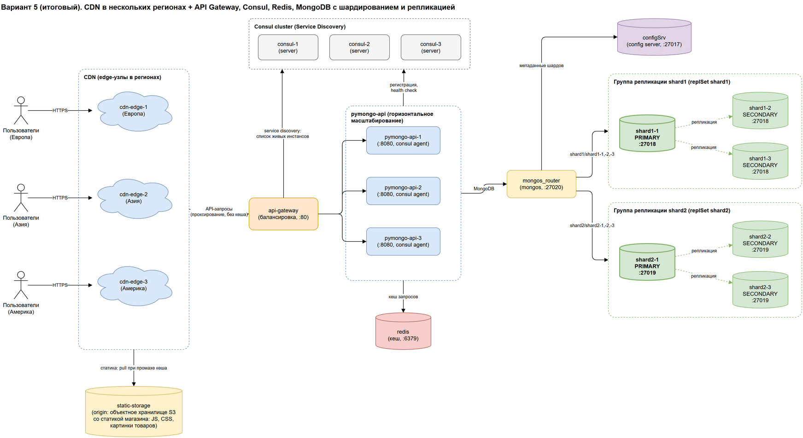

# Мобильный мир: шардирование, репликация и кеширование MongoDB

Проектная работа 4 спринта. Исходный стенд (`pymongo-api` и один инстанс MongoDB) масштабирован: MongoDB разбита на два шарда, у каждого шарда три реплики, запросы приложения кешируются в Redis. На схеме также показаны горизонтальное масштабирование приложения (API Gateway + Consul) и CDN.

## Структура репозитория

| Путь                                                | Что внутри                                                                                   |
|-----------------------------------------------------|----------------------------------------------------------------------------------------------|
| [`architecture.drawio`](architecture.drawio)        | Схемы (задания 1, 5, 6), по странице на каждый этап; итоговая — страница «5. CDN (итоговая схема)» |
| [`mongo-sharding/`](mongo-sharding)                 | Задание 2: два шарда, сервер конфигурации, роутер                                            |
| [`mongo-sharding-repl/`](mongo-sharding-repl)       | Задание 3: то же + по три реплики у каждого шарда                                            |
| [`sharding-repl-cache/`](sharding-repl-cache)       | Задание 4 (финальная реализация): то же + Redis                                              |
| `compose.yaml`, `api_app/`, `scripts/`              | Исходный стенд с одним инстансом MongoDB                                                     |

В каждой директории заданий есть свой `README.md` с шагами инициализации, `compose.yaml` и `scripts/mongo-init.sh`. Везде используется образ приложения `kazhem/pymongo_api:1.0.0`.

## Итоговая схема



## Как запустить финальную реализацию

Нужны Docker с Compose и минимум 2 CPU и 4 ГБ ОЗУ.

```shell
cd sharding-repl-cache
docker compose up -d
./scripts/mongo-init.sh
```

`mongo-init.sh` инициализирует сервер конфигурации и группы репликации `shard1` и `shard2` по три реплики, добавляет шарды в роутер, шардирует коллекцию `somedb.helloDoc` по хешу поля `name`, вставляет 1000 документов и выводит количество документов и реплик в каждом шарде:

```text
Всего документов: 1000
shard1: документов 492, реплик 3
shard2: документов 508, реплик 3
```

Статус сервисов:

```shell
docker compose ps
```

## Как проверить

### Если вы запускаете проект на локальной машине

Откройте в браузере http://localhost:8080. Приложение вернёт JSON с информацией о MongoDB:

- `mongo_topology_type: "Sharded"`, `mongo_is_mongos: true`;
- `collections.helloDoc.documents_count: 1000` — общее количество документов;
- `shards` — шарды `shard1` и `shard2`, у каждого по три реплики;
- `cache_enabled: true` — кеш в Redis включён.

Кеширование эндпоинта `/<collection_name>/users`: первый вызов занимает около секунды, повторные — меньше 100 мс:

```shell
for i in 1 2 3; do curl -s -o /dev/null -w "call $i: %{time_total}s\n" http://localhost:8080/helloDoc/users; done
```

```text
call 1: 1.016243s
call 2: 0.005547s
call 3: 0.005205s
```

### Если вы запускаете проект на предоставленной виртуальной машине

Узнать белый ip виртуальной машины

```shell
curl --silent http://ifconfig.me
```

Откройте в браузере http://<ip виртуальной машины>:8080

## Доступные эндпоинты

Список доступных эндпоинтов, swagger http://<ip виртуальной машины>:8080/docs

## Как остановить

```shell
docker compose down -v
```

Стенды заданий используют одни и те же имена контейнеров и порты, поэтому перед запуском другого стенда остановите текущий.
